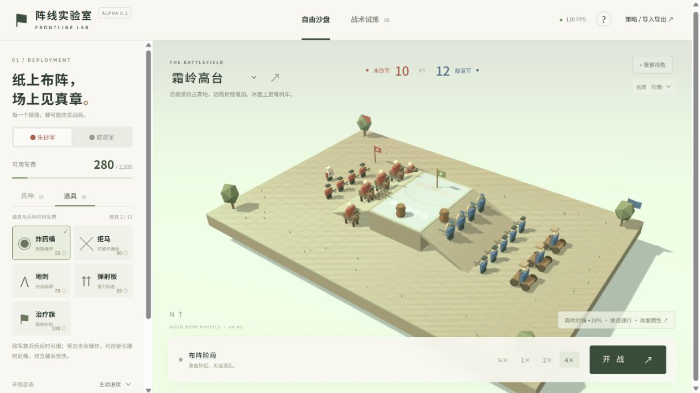

# 阵线实验室 · Frontline Lab

一个能在浏览器里玩的 **3D 物理混战沙盘**。花军费、排兵布阵，然后看长枪、弓箭、炸弹、碰撞与重力把计划变成意外。

原创实现，玩法灵感来自 [《纸上谈兵》 / meow-ai-arena](https://github.com/chen-006/meow-ai-arena) 与全面战争式物理沙盘。没有复用原项目的代码、素材、模型提交或关卡。



## 开始玩

需要 **Node.js 22.12+** 和支持 WebGL 2 的现代浏览器。无需模型 API Key、数据库或账号。

```sh
npm ci
npm run dev
```

打开终端显示的本地地址。生产构建：

```sh
npm run build
npm run preview
```

`dist/` 可放到任意静态托管平台。资源使用相对路径，适用于 GitHub Pages 的仓库子路径。首次安装需要联网；构建后的游戏不依赖 CDN、外部字体或外部 API。

## Alpha 0.1 有什么

- Three.js 3D 战场，程序化低多边形士兵、树木、旗帜与地形。
- Rapier 刚体模拟：身体碰撞、带连续碰撞检测的弹道、爆炸冲量、悬崖坠落。
- 六种兵种：游勇、盾卫、长枪兵、弓手、掷弹兵、大锤。
- 阵亡后生成 6 个刚体、5 个球关节组成的布娃娃，18 秒后清理。
- 三张战场：风起草甸、独木危桥、浮岛角斗场。
- 自由沙盘、三个固定对手试炼、三套预设军队。
- ¼× / 1× / 2× / 4×、暂停、轨迹回放与时间轴。
- 对局 JSON 导入导出、浏览器本地保存、随机种子、无界面批量评测。
- 中文桌面与窄屏布局，自动化测试与 GitHub Actions 检查。

## 操作

| 操作                      | 效果               |
| ------------------------- | ------------------ |
| 点选兵种 → 左键点本方场地 | 招募并放置         |
| 右键点击 / Shift + 左键   | 移除本方单位       |
| 左键拖动                  | 旋转视角           |
| 右键拖动                  | 平移视角           |
| 滚轮 / 双指               | 缩放               |
| 空格                      | 开战 / 暂停 / 继续 |
| R                         | 返回布阵           |
| Ctrl + Z                  | 撤销布阵           |

自由沙盘默认每方 1,500 军费、最多 45 人。点击阵营名称编辑另一方。试炼的玩家军费独立受关卡限制，对手阵型固定。

## 规则

移动和碰撞在固定的 **1/60 秒** 步长下模拟。近战采用距离和冷却判定；身体、抛射物、爆炸击飞与布娃娃由 Rapier 物理求解。活着的单位锁定转动保持直立，死亡后才转为关节布娃娃。

| 兵种   | 军费 | 生命 | 作用                       |
| ------ | ---: | ---: | -------------------------- |
| 游勇   |   40 |   80 | 快速低价近战               |
| 盾卫   |   90 |  220 | 正面减伤 60%               |
| 长枪兵 |   75 |  100 | 长距离突刺和击退           |
| 弓手   |  110 |   65 | 预测移动、真实弹道、可误伤 |
| 掷弹兵 |  180 |   85 | 1.8 秒延时爆炸，不分敌我   |
| 大锤   |  320 |  620 | 范围近战、重击冲量         |

单位坠落至 y < -4 时出局。全歼获胜；90 秒后按 `Σ(剩余生命 / 最大生命 × 兵种造价)` 判胜，差值小于 1 判平。三种开场行为为主动进攻 `advance`、原地防守 `hold`、侧翼迂回 `flank`。危桥使用简单航点导航，拥挤、推挤和爆炸仍可能让单位落水。

## 让 AI 布阵

将 [AI 提示词](docs/AI_PROMPT.md)、[兵种数据](src/data.js) 和 [示例对局](examples/bridge-battle.json) 交给 coding agent。AI 生成对局 JSON 后可直接在网页“策略 / 导入导出”中载入。

```sh
npm run battle -- --config examples/bridge-battle.json
npm run battle -- --map meadow --red volley --blue rush --rounds 10
npm run battle -- --map bridge --red balanced --blue titans --seed 42 --out result.json
```

`--rounds` 按种子递增运行，最多 100 局。输出每局胜方、时间、存活人数及汇总。网页与 CLI 共用 `src/engine.js`。

这个 Alpha 的 AI 接口是**布阵 JSON 和三种内置行为**，暂不支持每回合调用 C++ / Python 指挥程序。导入内容只解析为数据，不执行脚本。

相同依赖版本、执行环境和种子可重复运行。网页回放使用当前对局记录的轨迹；尚未提供回放文件导出、跨物理引擎版本复现或跨平台逐位一致性保证。

## 开发

```sh
npm test
npm run build
```

测试覆盖：同输入复现、三张图完整结算、六刚体五关节布娃娃、爆炸友伤与冲量、落崖出局、盾牌朝向减伤、90 秒超时、非法导入。

```text
src/data.js       兵种、地形、阵型、关卡、输入校验
src/engine.js     Rapier 模拟，浏览器与 Node 共用
src/scene.js      Three.js 场景、模型与轨迹显示
src/main.js       布阵、游戏状态、导入导出、回放 UI
scripts/         无界面评测与示例生成
test/            Node 内置测试
examples/        可直接载入的对局文件
```

数值在 `src/data.js` 集中维护。添加兵种时同步修改 `scene.js` 的武器与外观。添加地形时让渲染几何体与物理碰撞体共用同一组平台描述。

## 当前边界与后续方向

这是可玩的早期沙盘，尚未达到原作的内容量。暂时没有骑兵、投石车、可破坏地形、在线匹配、排行榜和可执行的逐帧指挥接口。导航使用简单寻敌、队友分离与危桥航点，可能在复杂拥挤下卡住；90 秒结算会结束僵局。高倍速或大量布娃娃会增加 CPU 开销，性能较弱的设备可缩减军队。

欢迎通过 Issue / PR 讨论下一步：可执行策略协议、更多地形、受击失衡、骑兵冲锋、社区对局、联赛与回放分享。提交前请运行测试和构建，说明玩法变化与验证结果。

## 协议与致谢

[MIT](LICENSE)。程序化美术与游戏代码随项目开放。依赖 Three.js（MIT）、Rapier（Apache-2.0）与 Vite（MIT）；依赖权利说明见 [THIRD_PARTY_NOTICES.md](THIRD_PARTY_NOTICES.md)。

感谢 [chen-006/meow-ai-arena](https://github.com/chen-006/meow-ai-arena) 提供玩法启发。
