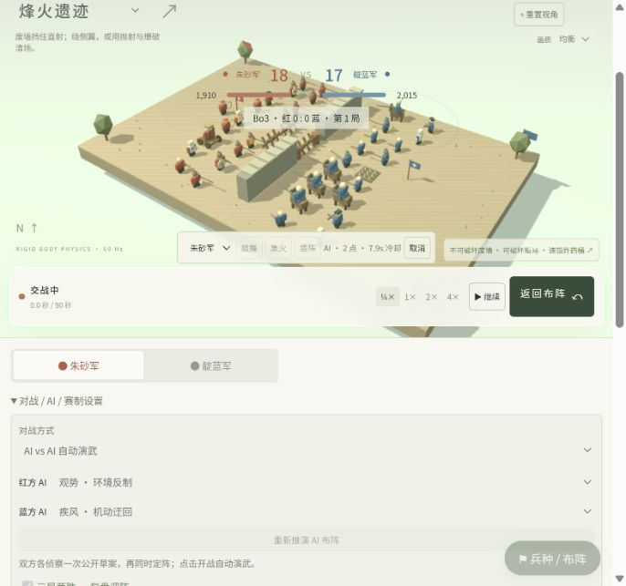

# 阵线实验室 · Frontline Lab

一个能在浏览器里玩的 **3D 物理混战沙盘**。花军费、排兵布阵、布置道具，然后看骑兵、弓箭、石弹、碰撞与重力把计划变成意外。

**Alpha 0.4：公开侦察与战报调阵、Bo3、同规则统帅军令、程序化音效、实时战力、姿态徽章、快捷视角和五槽收藏。** 保留十种兵种、六张地图、五种道具、人机 / 双 AI / 盲选热座。原创实现，玩法灵感来自 [《纸上谈兵》 / meow-ai-arena](https://github.com/chen-006/meow-ai-arena) 与物理战斗沙盘，没有复用其代码、素材、选手提交或关卡。



## 开始玩

需要 **Node.js 22.12+** 和支持 WebGL 2 的现代浏览器。无需模型 API Key、数据库或账号。

```sh
npm ci
npm run dev
```

打开终端显示的本地地址。生产构建：

```sh
npm run build
npm run preview
```

`dist/` 可放到任意静态托管平台。资源使用相对路径，适用于 GitHub Pages 的仓库子路径。首次安装需要联网；构建后的游戏不依赖 CDN、外部字体或外部 API。

## 0.4 更新

- 反制 AI 同时分析重甲、突进、后排集群与空间展开；根据上一局敌方贡献兵种和己方重创侧翼调阵。
- Bo3 保留双方每局阵型与公开战报；人类可微调，AI 可复盘；先两胜或最多三局结束。
- 可选统帅军令：双方每局各 3 点、统一 8 秒冷却，鼓舞 / 集火 / 盾阵共用 `issueOrder()`，记录进回放。
- Web Audio 零外部资源合成音效，支持静音 / 音量；实时战力条、轻震动、命中治疗光效和增益圈。
- 开场 / 暂停姿态徽章，俯视 / 全览 / 跟随视角；窄屏浮动兵种条、折叠抽屉、五槽本地收藏。
- 新回放 v2 支持军令；旧 v1 轨迹与 0.1 / 0.2 / 0.3 种子按对应冻结模拟器兼容。原有 48 项加 14 项，共 62 项测试。

完整规则与工程口径见 [v0.4 开发说明](docs/V0.4.md)。

## 0.3 基础能力

- 稳健守阵、机动迂回、环境反制三种付费且合法的布阵 AI，网页与 CLI 共用。
- 一键玩家 vs AI、AI vs AI；热座按红方封存、交接遮屏、蓝方布阵、揭晓开战，隐藏对方数量和道具。
- 常规推进 / 坚守阵地 / 侧翼迂回 / 猎杀远程四种姿态；可对选中部队批量设置。
- 方阵、横排、楔形混编与镜像追加；框选或按兵种选择后移动 / 删除。悬停显示地形贴合的射程和道具作用圈。
- 战果增加分兵种战损、贡献、单位榜和 MVP；支持双方独立 JSON / AI 策略评测与完整战报。
- 局部受阻脱困、倒马 / 碎车视觉残骸、完整轨迹或种子回放包导入导出；兼容 0.1 / 0.2 布阵。
- 保留 60 Hz、实例合批、3 米网格、每六步寻敌和 24 组尸体上限。原有 26 项测试加 22 项，总计 48 项。

使用方法、数据结构、统计口径与局限见 [v0.3 开发说明](docs/V0.3.md)，回放契约见 [回放格式](docs/REPLAY_FORMAT.md)。

## 0.2 基础能力

- 新增骑兵、弩手、军医、投石车，分别提供冲锋、破盾、治疗和高抛范围冲击。
- 新增烽火遗迹、雾沼营地、霜岭高台。废墙阻挡弹药；沼泽减速；坡道可通行；高地增加射程；冰面保留更多惯性。
- 炸药桶、拒马、地刺、弹射板、治疗旗可以在本方半场布置，和兵种共用军费。地图也自带中立道具。
- 六个战术试炼、六套推荐军队、每方最多 60 人和 12 件道具。默认军费 2,200，可在策略面板调整到最高 10,000。
- 使用实例化合并单位绘制、空间网格邻近查询、10 Hz 寻敌和画面快照复用。新增三档画质和帧率显示。
- 保留暂停、¼× / 1× / 2× / 4×、轨迹回放、时间轴、JSON 导入导出、浏览器本地保存和 CLI 批量评测。兼容 0.1 对局文件。

## 操作

| 操作                           | 效果               |
| ------------------------------ | ------------------ |
| 选兵种 / 道具 → 左键点本方场地 | 招募并放置         |
| 右键点击 / Shift + 左键        | 移除本方单位或道具 |
| 左键拖动                       | 旋转视角           |
| 右键拖动                       | 平移视角           |
| 滚轮 / 双指                    | 缩放               |
| 空格                           | 开战 / 暂停 / 继续 |
| R                              | 返回布阵           |
| Ctrl + Z                       | 撤销布阵           |

自由沙盘可编辑双方。试炼只编辑朱砂军，军费受关卡限制。点击战场上的地形说明，查看当前地图和道具效果。地图自带的道具不能在布阵阶段移除，但可在战斗中被破坏。

## 兵种

| 兵种   | 军费 | 生命 | 作用                                 |
| ------ | ---: | ---: | ------------------------------------ |
| 游勇   |   40 |   80 | 快速低价近战                         |
| 盾卫   |   90 |  220 | 正面减伤 60%                         |
| 长枪兵 |   75 |  100 | 长距离突刺；克制高速骑兵             |
| 弓手   |  110 |   65 | 预测移动、真实弹道、可误伤           |
| 掷弹兵 |  180 |   85 | 1.8 秒延时爆炸，不分敌我             |
| 大锤   |  320 |  620 | 范围近战、重击击退                   |
| 骑兵   |  190 |  245 | 持续奔跑后的冲锋增加伤害与击退       |
| 弩手   |  160 |   90 | 低弧度直射，部分穿透盾牌减伤         |
| 军医   |  160 |  100 | 每秒治疗六米内伤势最重的活友军 16 点 |
| 投石车 |  280 |  240 | 高抛石弹，命中后范围冲击，可造成友伤 |

## 地形与道具

| 地图       | 可利用的地形                                                          |
| ---------- | --------------------------------------------------------------------- |
| 风起草甸   | 开阔地，自由组织火力线与掩体                                          |
| 独木危桥   | 狭桥和深谷，炸药桶与击退能决定桥头战斗                                |
| 浮岛角斗场 | 四面临空，弹射与重锤都有风险                                          |
| 烽火遗迹   | 不可破坏的废墙；中央和两侧开口；中立拒马与连锁炸药桶                  |
| 雾沼营地   | 沼泽中速度为 45%；两侧快路；中立补给旗与地刺                          |
| 霜岭高台   | 可通行坡道，地面比目标高一米以上时远程射程 +18%；台顶冰面降低横向控制 |

| 道具   | 军费 | 效果                                                              |
| ------ | ---: | ----------------------------------------------------------------- |
| 炸药桶 |   65 | 敌军靠近后延时引爆，受击也会爆炸。爆炸可连锁引爆附近桶并造成友伤  |
| 拒马   |   80 | 有生命值的实体掩体，阻挡移动和弹药，可被近战或炮火拆毁            |
| 地刺   |   70 | 对敌军造成周期伤害；中立地刺对双方生效                            |
| 弹射板 |   85 | 将踩上的单位向前上方弹射，间隔 1.5 秒，可越过战线，也可能造成坠落 |
| 治疗旗 |  100 | 每秒治疗 3.2 米内友军 10 点；中立旗对双方生效，旗杆可被毁         |

## 模拟规则

Rapier 以固定的 **1/60 秒** 步长处理刚体移动、碰撞、抛射物、爆炸冲量和六刚体五球关节布娃娃。近战使用距离与冷却判定。活兵锁定旋转保持直立，阵亡后转换为布娃娃；骑兵和投石车的碰撞体仍是简化胶囊，另有随尸体生命周期回收的倒马 / 碎车视觉残骸。

单位坠落至 y < -4 时出局。全歼获胜；90 秒后按 `Σ(剩余生命 / 最大生命 × 兵种造价)` 判胜，差值小于 1 判平。道具不计为需要消灭的士兵。常规推进 `advance`、坚守阵地 `hold`、侧翼迂回 `flank`、猎杀远程 `hunt` 是四种内置行为。危桥、遗迹和高台使用入口与出口航点，迂回单位会选择遗迹外侧通道及沼泽侧路。

## 让 AI 布阵与批量评测

将 [AI 提示词](docs/AI_PROMPT.md)、[兵种和地图数据](src/data.js) 以及 [高台示例](examples/highland-skirmish.json) 交给 coding agent。AI 生成对局 JSON 后可在网页“策略 / 导入导出”中载入。

```sh
npm run battle -- --config examples/highland-skirmish.json
npm run battle -- --map ruins --red siege --blue cavalry --rounds 10
npm run battle -- --config examples/large-battle.json --out result.json
npm run battle -- --red-ai maneuver --blue-ai counter --map ruins --rounds 2 --out result.json
npm run battle -- --red file:red-army.json --blue file:blue-army.json --map meadow --out result.json
npm run battle -- --config examples/ai-duel.json --replay-out replay.json
npm run battle -- --red-ai counter --blue-ai maneuver --map ruins --bo3 --commander --out bo3.json
```

`--rounds` 按种子递增，最多 100 局。网页与 CLI 共用 `src/engine.js`。`examples/bridge-battle.json`、`examples/highland-skirmish.json` 和 `examples/large-battle.json` 均可直接导入网页。

AI 接口是**布阵 JSON、道具、四种内置行为与结构化贡献战报**；暂不支持每回合调用外部 C++ / Python 指挥程序，导入内容只解析为数据。详见 [AI 接口说明](docs/AI_PROMPT.md)。

## 性能与验证

```sh
npm test
npm run build
npm run benchmark
```

v0.4 与干净 v0.3 的同进程交替基准为 0.3340 → 0.3392 ms/步，增加约 1.53%，通过 10% 回退门槛。普通基准为 0.3408 → 0.3220 ms/步；不同测量存在负载与 JIT 波动，原始样本与历史版本记录均保存在 [性能记录](docs/PERFORMANCE.md)。这些不是所有设备的帧率保证。

三档画质只改变像素比和阴影，物理规则一致。物理尸体最多保留 24 具、12 秒后移除；尸体只与地形和掩体发生接触，爆炸仍能推动它们。

自动化测试覆盖六张图完整结算、六关参考方案可通关、寻敌复现、布娃娃、投射物与掩体、连锁爆炸与友伤、骑兵冲锋、军医和旗帜治疗、地刺、弹射板、沼泽减速、坡道支撑、高地射程、冰面惯性、迂回通道、快照隔离、实例合批以及导入校验。

新增测试覆盖 AI 合法性与反制、四种姿态、盲选隔离、混编与批量移动、贡献统计、回放往返与非法输入、防卡死和独立双方 JSON CLI；v0.4 再补公开侦察、Bo3、军令公平与重演、战力计算、旧回放、收藏和音效节流，共 62 项。

相同依赖、环境、输入、种子与军令日志可复现。v0.4 支持回放 v2 和旧 v1，旧种子按对应 0.1 / 0.2 / 0.3 模拟器重演；回放文件最多 64 MB。没有跨平台逐位一致性的保证。旧布阵能载入，新版本重新开战时仍使用新规则。

## 开发结构

```text
src/data.js        兵种、道具、地形、阵型、关卡、输入校验
src/tactics.js     共用战术 AI 规划与公平双 AI 草案侦察
src/deployment.js  混编、原子编辑、热座可见性
src/replay.js      有界回放包校验、轨迹/种子格式
src/series.js      Bo3 比分、配置与公开战报档案
src/favorites.js   五槽收藏、镜像与军费校验
src/audio.js       合成音效、交互解锁与节流
src/legacy/        冻结的旧模拟器与数据，仅旧种子重演时加载
src/engine.js      Rapier 模拟与空间索引，浏览器与 Node 共用
src/batches.js     动态网格实例合批
src/scene.js       Three.js 场景、模型和轨迹显示
src/main.js        布阵、道具、状态、存档、回放和 UI
scripts/          无界面评测、基准测试、示例生成
test/             Node 内置测试
```

目前仍是早期沙盘。尚无在线匹配、排行榜、桥面破坏、任意程序指挥或复杂导航网格。拥挤和复杂障碍可能造成停滞，90 秒结算结束僵局。欢迎提交 Issue / PR；提交前运行测试与构建，并说明玩法变化和验证结果。

## 协议与致谢

[MIT](LICENSE)。程序化美术与游戏代码随项目开放。依赖 Three.js（MIT）、Rapier（Apache-2.0）和 Vite（MIT），见 [第三方说明](THIRD_PARTY_NOTICES.md)。感谢 [chen-006/meow-ai-arena](https://github.com/chen-006/meow-ai-arena) 的玩法启发。
