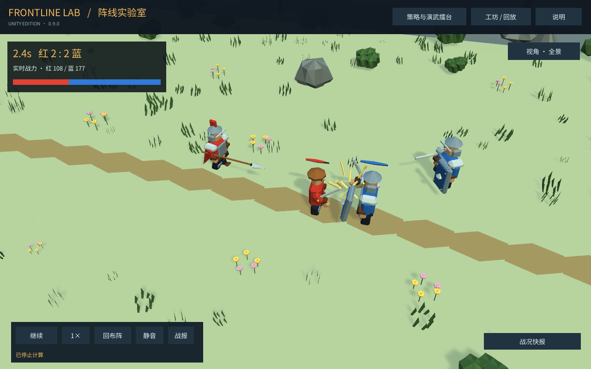

# 阵线实验室 · Unity Edition

原生 Unity 3D 物理对战沙盘，支持 **Windows x64 + WebGL 网页版**。10 个兵种、6 张地图、5 种道具，以及人机、双 AI、热座、Bo3、统帅军令、算策推演、演武擂台与高光回放。

游戏版本 **0.9.5**，Unity **6000.6.9f1**。运行时使用 C# + Unity PhysX，60Hz 固定步长、3 米空间网格和 GPU 实例合批。Three.js / Rapier 仅保留为旧回放转换与回归工具，不在 Unity 成品中运行。



v0.9 放大金属格挡火花、加入举盾回弹和近战闪影，新增强击退撞墙尘雾/音效，修正物理转向与窄口脱困，收紧战斗 HUD 并恢复实时战力条。保留128个顶点色网格、六图纯视觉生态、三档画质与历史适配器。完整测试、双测法性能和真实截图见 [v0.9 验证记录](docs/V0.9_VALIDATION.md)；[v0.8记录](docs/V0.8_VALIDATION.md)保留原始对照。

## 构建与运行

安装并激活上述 Unity Editor，同时安装 Web Build Support。开发工具需要 Node 22.12+；独立规则检查需要 .NET 8 SDK。

```powershell
npm ci
npm test
npm run build
npm run dev
```

浏览器打开终端显示的本地地址。Windows 运行 `Builds/Windows/FrontlineLab.exe`，网页完整目录为 `dist/`。Editor 路径不同时设置 `UNITY_EDITOR_PATH`。详情见 [Unity 迁移与操作说明](docs/UNITY_MIGRATION.md)。

## 验证与智能体

```powershell
npm run test:physics
node Tools/unity.mjs smoke
npm run benchmark
npm run tournament -- --maps meadow,bridge --seeds 42,77
npm run agent-battle -- --red-bot red-bot.json --blue-bot blue-bot.json
```

两个本地 Bot 通过版本化 stdio 协议接收脱敏公开战场并发出军令。所有军令使用同一规则校验，超时跳过，输出 Bo3 战报和可播放的 v3 轨迹。参见 [Agent 协议](docs/AGENT_PROTOCOL.md) 与 [迁移说明](docs/UNITY_MIGRATION.md)。网页可导入外部 Bot 回放，外部进程桥接需使用 Windows 版。

## 历史兼容

0.1–0.7 产品生成的布阵可导入（布阵存档 schema 仍为0.6.0），完整轨迹回放可直接播放。旧种子包先展开为完整轨迹：

```powershell
node Tools/convert-legacy-replay.mjs old-seed.json full-trajectory.json
```

更换物理引擎后，旧 Rapier 的种子不会在 PhysX 中得到相同结果。跨平台复盘应交换完整轨迹；0.6 Unity 种子由冻结的适配器重建；0.7 新种子使用 unity-0.7.0。原生种子仅用于同引擎和同平台复现。

## 目录

- `Unity/Assets/Frontline/Core`：与引擎无关的数据、规则、AI、擂台、回放和协议。
- `Unity/Assets/Frontline/Runtime`：Unity 物理、渲染、界面、文件桥与原生无头工具。
- `Unity/Assets/Frontline/Editor`：工程准备、构建和 Play Mode 检查入口。
- `Tools`：构建与验证命令、旧回放转换、测试替身与兼容样例。
- `src` / `test` / `scripts`：冻结的旧版工具与 77 项回归测试；[旧版说明](docs/LEGACY_README.md)。

源码 MIT。中文字体为 Noto Sans CJK，附 OFL。原创游戏实现，玩法灵感来自物理混战沙盘，没有复用其他游戏的源码、素材或选手提交。

0.6、0.7 与 0.8 Unity 种子使用冻结规则及对应的历史物理适配器；0.9 新种子标识为 `unity-0.9.0`。完整轨迹仍为 v3，旧帧新增视觉字段缺省为零，重新导出保持历史完整 JSON 一致。
