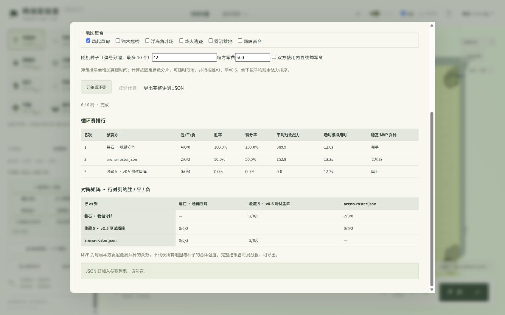
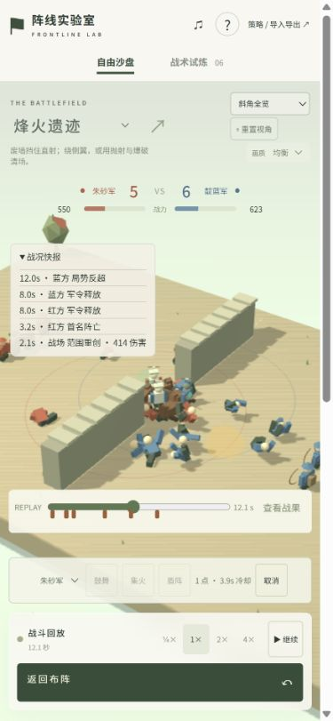

# v0.5.0 实测与交付记录

日期：2026-11-17。所有条目是本轮实际运行结果；历史 v0.4 交接记录另存，不冒充本轮测试。

## 自动化与构建

- Windows、Node.js v26.13.0、锁定 Three.js / Rapier / Vite 依赖；没有新增运行时依赖。
- `npm test`：**77/77**，失败 0，约 51.84 秒。原有四个测试文件、62 项断言用例均未改动；新增 15 项。原有枚举全部 AI 的测试现在也会完整执行 oracle，耗时相应增加。
- 新增六地图对照：v0.4 / v0.5 相同输入的 RNG、单位、弹道、尸体、军令与视听提示快照逐项一致。0.4 种子与轨迹使用冻结引擎重演，原有 0.1–0.3 兼容测试继续通过。
- `npm run build`：成功，最后一次约 259 ms；仍有 >500KB 包提示，已如实保留。
- 主协调器约 502 行；相对模块依赖图无循环，原有 DOM ID 保持。

## 性能与体积

固定 45v45、种子 42、720 步、每六步快照，六次去一预热，剩五次中位数。独立运行基准；不与测试或锦标赛并发。

| 对照 | v0.4 ms/步 | v0.5 ms/步 | 变化 |
| --- | ---: | ---: | ---: |
| 普通前后命令 | 0.3168 | 0.3809 | +20.24% |
| 首轮同进程交替 | 0.3390 | 0.3419 | +0.87% |
| 最终同进程交替 | 0.3515 | 0.3497 | -0.50% |

普通前后测受时段、背景负载和 JIT 影响，不能据此单独归因为版本回退。两轮相同进程交替均通过原有 10% 守门，未删掉较慢样本。原始 JSON 位于 performance-v0.5-*.json，不能把 ms/步换算成跨设备 FPS 保证。

首屏 HTML + CSS + 入口 JS + 必需 WASM：未压缩 5,060,978 → 4,053,629 字节（-19.90%）；gzip 估算 1,840,122 → 1,417,644 字节（-22.96%）。构建时逐字节校验了外置 WASM 与原内嵌载荷相同。完整文件列表见 build-v0.5-metrics.json；这不是网络实测速率。

## CLI 实战

- `npm run agent-battle -- --out-dir ...`：两个独立 Node stdio Bot 完成三局 Bo3，红 1 / 蓝 2，18 道军令，无超时。三局完整 v2 回放均生成，网页已实际导入第一局。
- 自动测试另用真实子进程验证超时、迟到 ID、非法指令、军令日志重演；生成产物经过同一 v2 校验。
- Python 示例已提供，当前环境没有 Python 命令，本轮未声称实际运行 Python 或任何模型 API。
- 四种 AI × 草甸/遗迹 × 种子 42/43 × 红蓝换边：**48 局**。磐石 21/0/3，算策 18/0/6，观势 9/0/15，疾风 0/0/24；这是该样本的胜/平/负，不是总体强度承诺。
- `tournament-json.json`：本地 JSON 枪医阵型与 guardian 的双向两局跑通。
- 原 battle CLI 也实际运行 oracle vs guardian，军费 500、草甸、种子 42，合法结算。

完整擂台逐局报告保留为 v0.5-tournament-full.json.gz；普通 JSON 提供排行、矩阵和逐局摘要。

## 真实浏览器

生产构建经 Vite preview 实测，独立 WASM 正常加载；桌面 **1440×900** 与窄屏 **390×844**。不是只改 CSS 标签或截图缩放。

- 桌面验证公开人机切换、oracle 进度/取消、两局 Bo3 到蓝方 2:0、下一局地图/赛制锁定、Space 暂停与继续、Tab 视角和数字军令。手动盾阵扣为 2 点并显示约 7.9s 冷却。
- 收藏保存/载入、JSON 导入擂台、AI + 收藏 + JSON 三方 **6 局**循环赛完成，排行、胜平负矩阵和 MVP 正常。
- 390px 验证拖拽模式不放兵，切换点选后成功放兵，Ctrl+Z 撤销；最后一轮生产页拖拽前后红方均 14 人。
- 导入外部双 Bot v2 回放，点击 12.0 秒反超刻度跳到 12.1 秒、timeline=121，快报恰好最近 5 条。
- 390px 下文档 scrollWidth=375 ≤ innerWidth=390；战场底边=844，回放栏、军令栏和底部操作栏边界实测不重叠，底部按钮完整处于视口内。
- 生产检查的浏览器 error / warning 日志为空。未声称完成实体手机多指硬件、所有音频设备或跨平台逐位确定性测试。

## 发布

沿用原 Sites 项目及 owner-only/custom 访问，不扩大访问权限；GitHub 原仓库 main 延续其原有历史。实际部署 ID 与公开提交记录在本次交付报告中。
