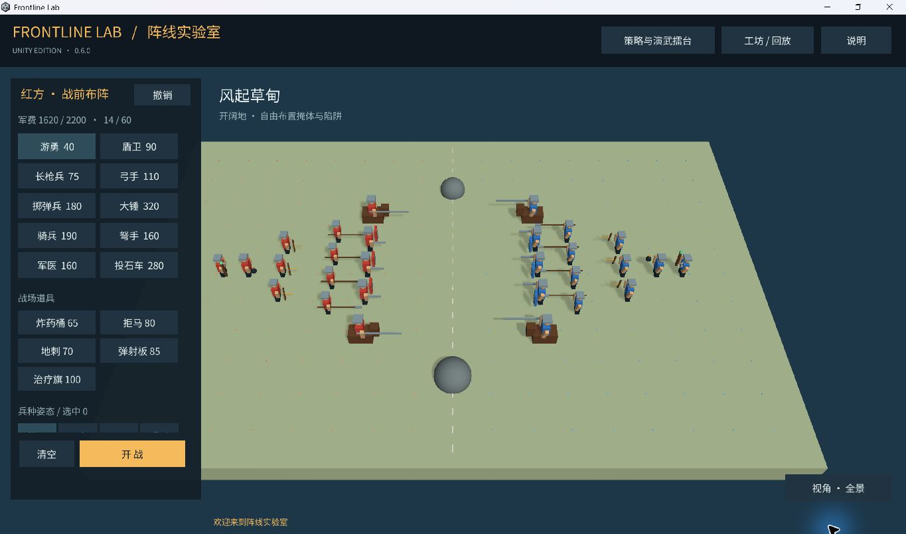
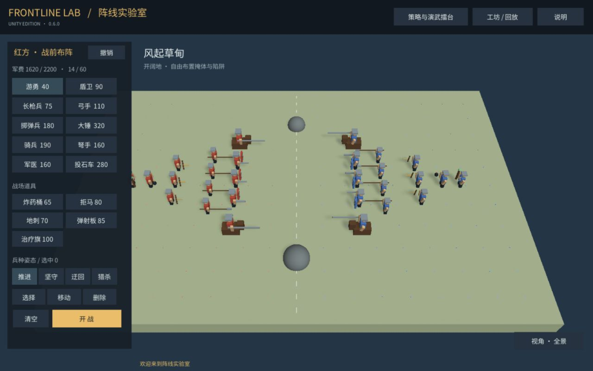
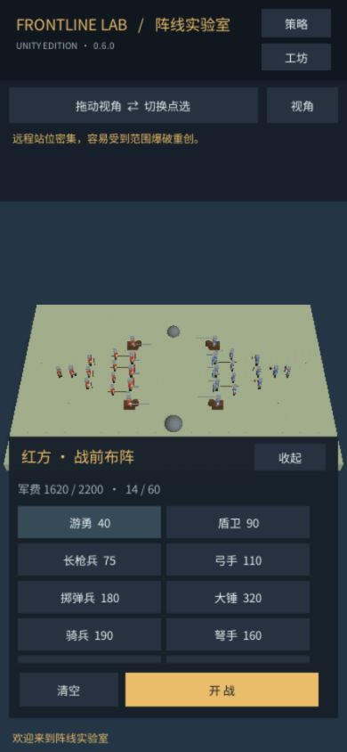
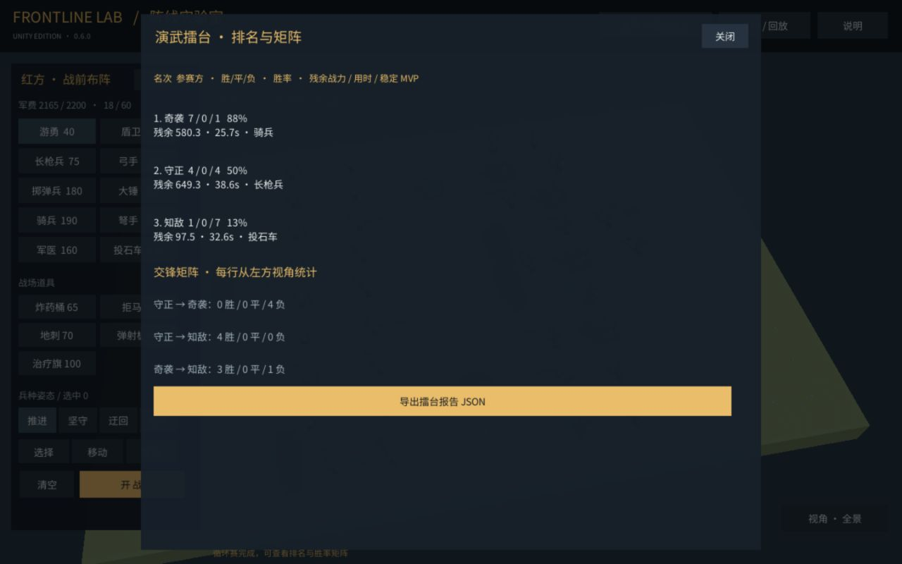

# 阵线实验室 Unity 0.6.0 实际验证

环境：Windows x64，Unity 6000.6.9f1。目标：Windows 原生与 WebGL。运行时使用 C#、Unity PhysX、固定 60Hz、3 米空间网格和实例合批。

## 已执行

| 检查 | 实际结果 |
| --- | --- |
| npm test | 原有 JS 77 项 + C# 61 项，共 138 项通过 |
| npm run build | Windows x64 与 WebGL 均成功 |
| 原生 checks | 相同构建两次完整战报一致，回放往返校验通过 |
| 原生 smoke | 六图完整结算，每图合法 v3 轨迹，见下表 |
| 双外部 Bot Bo3 | 2 局，红 2 : 蓝 0；106 次观察、12 条军令、0 拒收、0 未响应 |
| 故意静默 Bot | 比赛正常完成；另一方 6 条军令；49 次未响应被跳过 |
| 原生 oracle 循环赛复现 | 两次报告 SHA-256 完全一致 |
| 浏览器 | 1280×800、390×844；实际开战、暂停、布兵/撤销、算策进度、12 局循环赛、报告下载、回放导入与高光跳转 |
| 字体 | 16,437,364 → 1,931,800 字节；8,065 字形；随包文本 731 个码点相对源字体无缺字 |

纯 C# 检查中的参考物理只是测试替身，不进入游戏；真实物理由上述 Unity 原生任务另行检查。390px 检查使用实际浏览器视口与指针手势，没有声称已在实体手机上完成多指触屏测试。Unity Editor 一次启动出现 SearchDatabase 索引异常；独立 Windows 玩家进程的 checks、smoke 和 Bot 测试不依赖该编辑器索引。

## 六地图原生对战

| 地图 | 步数 | 胜方 | 帧数 | 军令 |
| --- | ---: | --- | ---: | ---: |
| meadow | 1467 | red | 246 | 6 |
| bridge | 1395 | red | 234 | 6 |
| island | 1787 | blue | 299 | 6 |
| ruins | 1573 | blue | 264 | 6 |
| marsh | 3147 | blue | 526 | 6 |
| highland | 3560 | blue | 595 | 6 |

## 性能实测与差距

独立运行、种子 42、720 固定步、每六步快照；六轮去掉第一轮预热，取其余五轮中位数。原始数据保存在 validation/。

| 场景 | CPU 模拟与快照 ms/步 |
| --- | ---: |
| Unity 默认 14v14 | 0.1767 |
| Unity 45v45 | 0.4366 |
| 旧 Rapier v0.4 45v45 | 0.3408 |

Unity 45v45 比此轮旧引擎基准增加 **28.1%**（约 0.0957ms/步），**没有满足原先 10% 的 CPU 无回退门槛**。它占 60Hz 单步 16.67ms 预算约 2.62%。不能把低于预算说成与 Rapier 完全持平，也不能从这份 CPU 基准推断所有手机或 GPU 的帧率。迁移同时更换了物理引擎，两份对战的数值轨迹并不相同。

已落实的优化包括：快照直接复制，避免热路径 JSON 往返；空间桶以值类型迭代；只有飞行物订阅碰撞回调；有限尸体；GPU 实例合批；标准 6/1 PhysX 求解预算。

## 兼容与限制

- 0.1–0.5 布阵可导入；五个旧版完整轨迹样例与实际 v0.5 Bot 回放已通过 C# 导入。
- 旧 Rapier 种子须使用 Tools/convert-legacy-replay.mjs 展开成完整轨迹。Unity 新轨迹/种子为 v3。
- 同一构建重复检查通过；不保证 PhysX 在不同平台或引擎版本间位级一致。跨平台交换完整轨迹。
- 外部子进程指挥在 Windows 版运行；网页提供回放导入。Native 擂台导入完整布阵 JSON；自定义 CLI 参赛方采用 Entrant 的 units/props 结构。
- 字体覆盖常用 GB2312 字、拉丁、符号和随包文本；罕用字名称可能显示缺字，JSON 数据不会丢失。

## 截图

原生 oracle 复现 SHA-256：

`167e8aef69f1e1a343023776e3fcd63b67d12888db97c08377a3b4d761d2dfb3`
