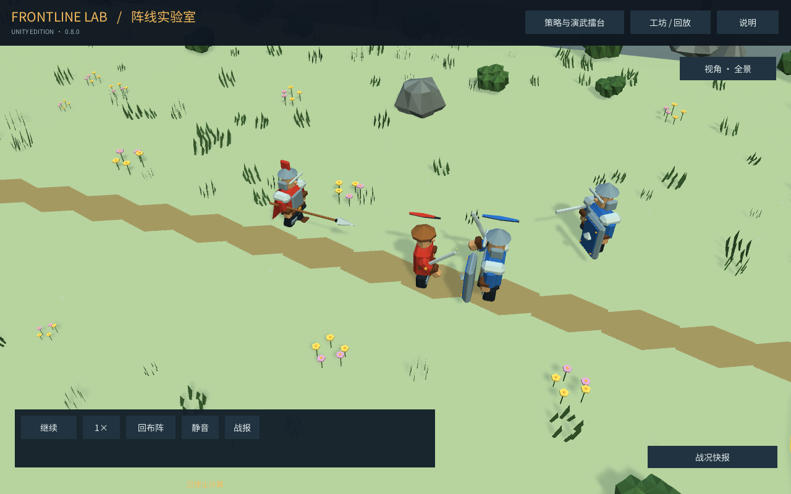
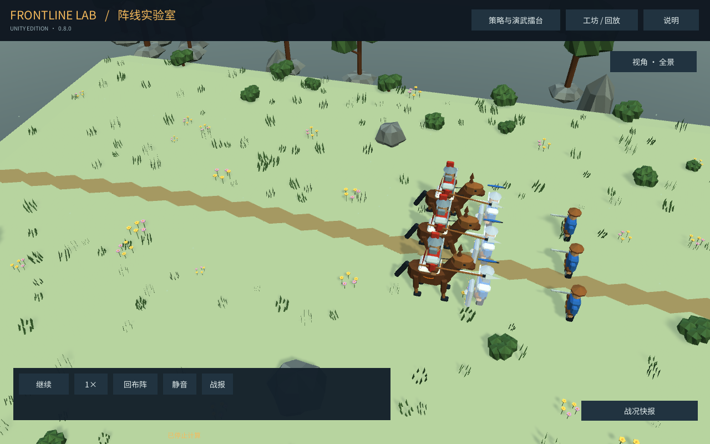
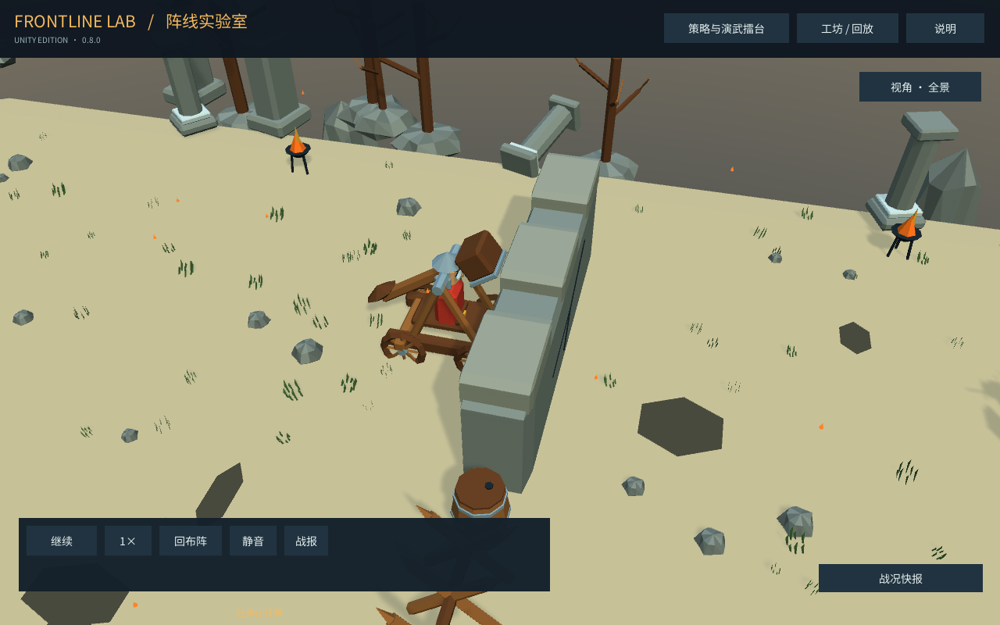
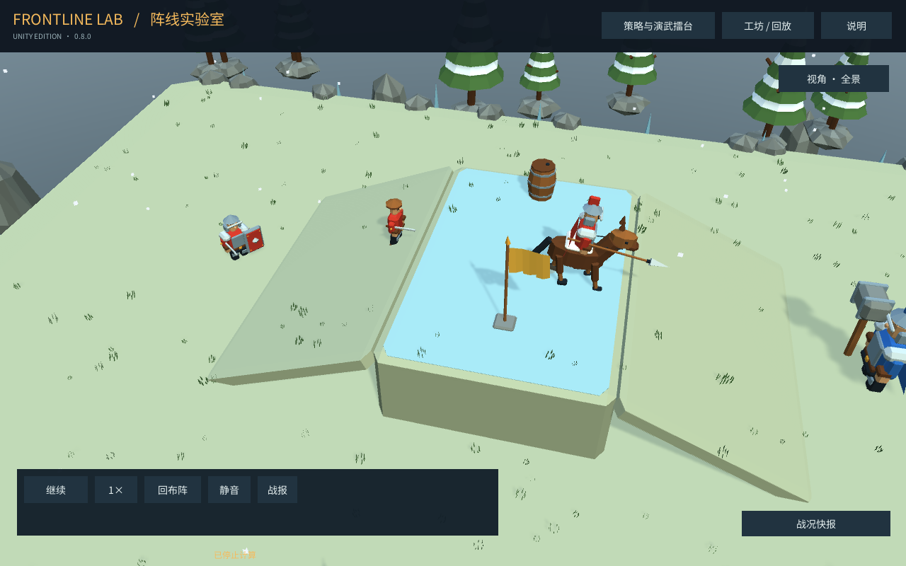

# Unity 0.8.0 验证记录

2026-11-17T16:16:50.619Z · Unity 6000.6.9f1 · Windows x64 / WebGL

受击、移动和碰撞升级已经完成。Core 零 UnityEngine、固定60Hz、3米网格、实例合批、冻结旧目录与0.1–0.7兼容路径均保留。布阵 schema 仍为0.6.0，新增战斗规则使用 unity-0.8.0 / 回放v3。

## 行为与真实物理

受击不再按1/6抽样。96个特效、24个音效提示预热复用；普通同目标4步节流，格挡/重击/致命命中绕过节流。六个可省略的浮点通道记录闪白、来向倾斜、实际平面速度/方向和累计步程。矩阵和实例参数直接表现，不增加材质或战斗刚体。盾牌正面击退系数0.22–0.40，轻/中/重硬直分别约0.055/0.13/0.42秒；重击能延缓前摇。

兵种角速度不同，骑兵随速度减小转向能力并保持前向惯性；静止停止摆腿，后撤反向步态，速度决定步幅与节奏。桥/门降低横向友军死顶；坡道按切线控制。实测发现高台冰面原静摩擦抵消低响应推力，已用低摩擦材质修正。

马身双胶囊随Y轴转向，车架为盒体，岩石为与视觉同朝向的最多64三角面凸包。按实际高速启用 ContinuousSpeculative。对象池启用后重设刚体发射姿态/速度，修复禁用状态写入被重置的问题；六刚体残骸保留真实出生姿态和动量。肩高箭能越过普通盾卫，低位箭仍被友军挡住；近距离友方/中立旗杆豁免0.10秒后恢复。

原生单骑碰撞用例禁用了普通攻击冷却，以确认命中确由实际接触触发：最高4.6684m/s、217步接触、正面盾卫生命220→193。桥/遗迹/高台8人纵队均8/8通过；高台下坡766次样本最大额外离地0.0321米。车架和24m/s战马墙体测试、双胶囊主人忽略、旗杆到期与池重用检查均通过。

## CPU：所有测法与中间失败

720步、每6步独立快照，预热1轮、测量5轮。预分配与物理池初始化不计入计时；实际开战前最多预分配902帧。以下为45v45中位数。

| 测量 | ms/步 |
|---|---:|
| Unity0.6历史 | 0.436569 |
| Rapier旧版 | 0.340828 |
| Unity0.7历史最终 | 0.284886 |
| Benchmark08Baseline | 0.290177 |
| Benchmark08First | 0.370698 |
| Benchmark08IsolatedInitial | 0.345039 |
| Benchmark08Hot | 0.386703 |
| Benchmark08Diagnostic2 | 0.339238 |
| Benchmark08Candidate | 0.324830 |
| Benchmark08Release | 0.337438 |
| Benchmark08ReleaseFresh | 0.349071 |

正式预分配测法满足≤0.34；fresh测法未满足，不能将其隐藏。正式预分配比0.7历史值上升18.4%，比本机0.7复测上升16.3%；新轮廓、真实发射、冲锋和战斗进程改变了负载。此结果不是“性能完全不变”。First为并行检查污染的诊断；Hot和Diagnostic2保留全部原始分轮值。详见JSON。

## 图形与每帧GC

| 成品 / 初始兵力 | 中位帧时ms | p95 ms | 实际Draw Calls |
|---|---:|---:|---:|
| Windows Release 45v45 | 16.668 | 16.750 | 92 |
| Windows Release 60v60 | 16.667 | 16.696 | 135 |
| WebGL 1280 45v45 | 8.000 | 9.000 | 90 |
| WebGL 1280 60v60 | 8.000 | 9.000 | 133 |
| WebGL 390 45v45 | 8.000 | 9.000 | 61 |
| WebGL 390 60v60 | 8.000 | 9.000 | 93 |

Draw Calls含阴影与UI，不把手工提交数称为实际Batches。网页毫秒计时量化，倒数FPS仅为近似；1280×800和390×844验收DPR=1。三档草木/粒子/阴影联动与静态缓存均检查，采样期间静态重建和对象池耗尽均0。

| Development / 初始兵力 | GC中位B/帧 | 平均 | 峰值 |
|---|---:|---:|---:|
| Windows 45v45 | 0 | 84.0 | 704 |
| Windows 60v60 | 0 | 88.6 | 568 |
| WebGL 45v45 | 0 | 28.8 | 432 |
| WebGL 60v60 | 0 | 30.4 | 344 |

Release线程分配接口校准无效，不将恒0当作零GC；Release不可读为-1。Development使用真实ProfilerRecorder，包含UI/验收开销。0.7 Windows Development平均约883/695B，本轮显著降低。

## 测试、回放与交付

npm test：87项JS+84项C#=171项全通过。新增覆盖平滑转向、盾牌减击退、重击延缓、池上限、独立快照、真实速度步态、后撤、坡道、窄口、发射和历史身份。npm run test:physics、独立checks、六图smoke、Bot Bo3均通过；完整当前回放两次逐字相同，最终1468步蓝胜。Bot Bo3红2:0，122次观察、12条合法军令、0拒收/超时。

冻结0.6/0.7规则和物理适配器后，完整历史轨迹SHA与原件逐字一致：

- unity-0.6.0：1847步red胜，SHA-256 195ba6c8be9e0eb0dad461e58fab4cb978b5f1266462c6b80c16dee0011bcc16
- unity-0.7.0：2279步blue胜，SHA-256 bdef881f7548d614c6633f635ad1472d92f5bcaebac4c44b59b4241535197249

实际WebGL工坊导入/导出的0.6、0.7、0.8完整轨迹对照见JSON crossPlatform字段。旧格式新增字段缺省0并省略写出。

npm run build等待退出0及两端FRONTLINE_BUILD_OK；正式包未混入Development成品。

- StandaloneWindows64：构建摘要81242738字节，00:00:13.2063510
- WebGL：构建摘要17896794字节，00:01:32.2990378

相对0.7构建摘要：Windows 0.09%，WebGL 0.99%。实际Web目录为9363721字节；交付ZIP精确大小、SHA与发布提交见交付目录release.json/SHA256。128个Mesh保留，无新增贴图。

原始截图交付含Windows、WebGL桌面与390px的连续冲锋/格挡帧、车架前后、窄口、高台和45/60兵力；对比页使用未修改原图，0.7默认阵型3秒作历史参照。车架图明确是一次前推冲量的受控碰撞用例。

## 限制与环境问题

- PhysX seeds require the same engine/platform/editor; portable replay uses complete trajectories.
- Mono/WebGL thread-allocation APIs fail calibration. Release GC=-1 is unavailable; genuine frame GC comes from Development ProfilerRecorder, including UI/QA overhead.
- Web millisecond timing is quantized; reciprocal FPS is approximate, not display refresh. QA uses DPR=1; ordinary site rendering allows DPR up to 2.
- Fresh snapshot CPU exceeds .34 ms/step. Prepared CPU also rises versus 0.7; the new physics workload is documented rather than called unchanged.
- Unity Editor SearchDatabase indexing exception persisted with exit 0; independent player checks passed. One temporary ILPP pipe build failure was retried successfully.
- 390px uses a real browser pointer; a physical phone multitouch session was not performed. Existing rare CJK font subset and Windows-only external process Bot limitations remain.
- The production site retains its existing owner-only audience and normal ChatGPT sign-in gate. A successful deployment is not a claim that a gated production battle was opened.
