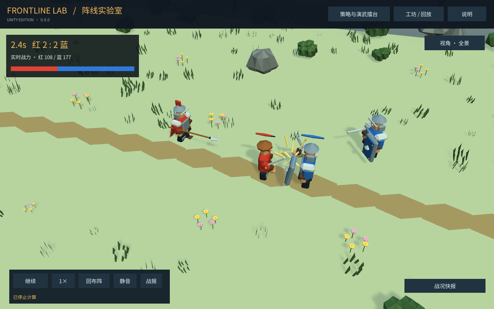
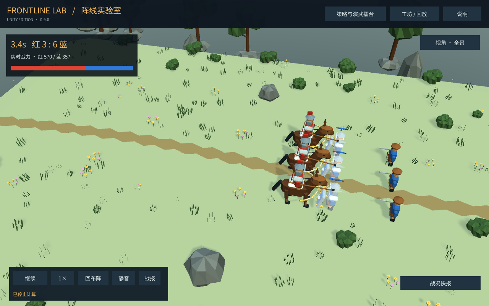
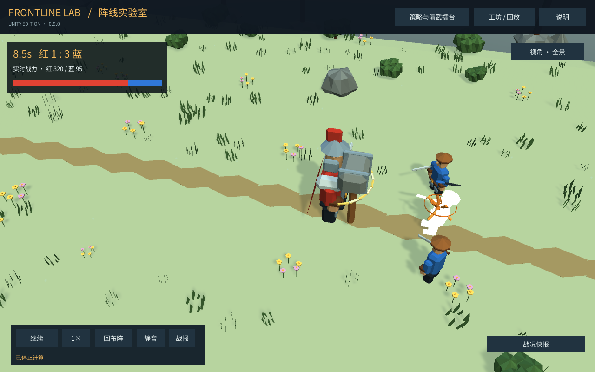
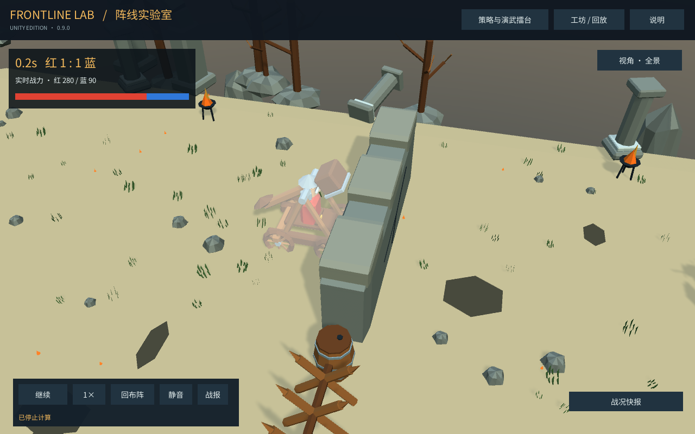
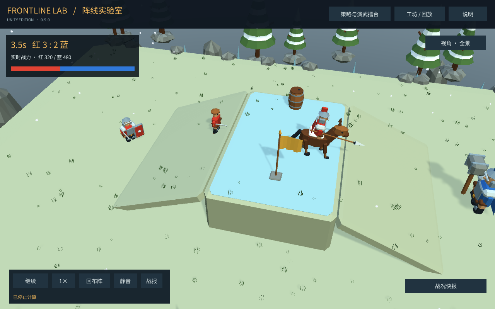
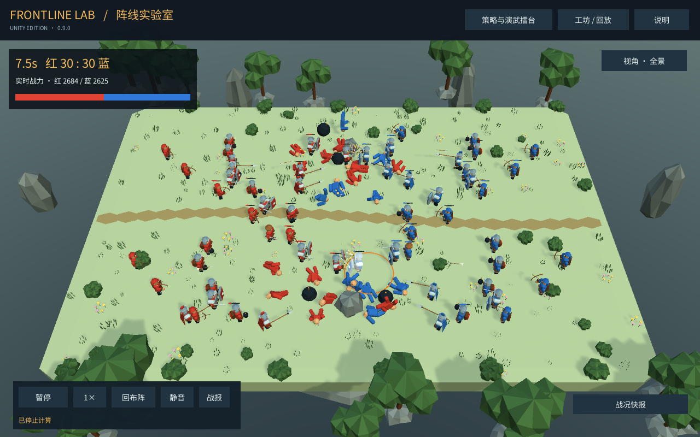

# Unity 0.9.0 验证记录

2026-11-17T20:01:46.661Z · Unity 6000.6.9f1 · Windows x64 / WebGL

Core 零 UnityEngine、60Hz固定物理、3米网格与实例合批保留。新增规则为 unity-0.9.0，布阵 schema 仍为0.6，完整回放v3。0.8规则、移动辅助函数和完整物理适配器冻结，旧种子身份不升级。

## 受击、物理与 HUD

格挡使用0.085米宽的放射亮条和0.95米交叉闪光，配合盾牌短暂上抬、前顶与回弹；重击、长枪、大锤和骑兵使用同一实例网格绘制闪影，不增加材质、刚体与贴图。强击退后60步内，单位高速碰撞真实墙、岩石或拒马可触发尘雾、低频撞击音和0.10秒震荡，12步同目标节流，普通地面/行走不触发。

骑兵回调先按层和阵营过滤地面/友军，再登记敌对冲锋接触；步兵不安装单位碰撞回调。墙、岩石和拒马的障碍回调只接收已被强击退标记的单位，避免普通接触采集。接触列表与去重集合各预留512项。马身/车架通过 MoveRotation 接受核心角速度限制，保留刚体旋转约束；0.015弧度以下的物理朝向变化合并提交，最大轮廓偏差约2厘米，视觉转向仍逐步更新。窄口维持低横向避让，连续受阻后仍能后退和切线试探。

控制死区与0.12m/s静止步态门槛一致，避免持续唤醒近乎静止单位。每步位置与速度读取缓存、标准重力弹内建重力、fresh帧独立缓冲精简降低原生调用和分配。六刚体残骸使用0.08自然休眠能量阈值，没有强制 Sleep；真实检查确认落地自然休眠且爆炸重新唤醒。碰撞轮廓与6/1求解迭代未降级。初始死亡与强爆炸后0.5秒使用原阻尼0.25/0.8，随后以0.85/3自然落稳；六刚体和关节继续参与物理。

索引目标遍历、短向量/地面查询内联、存活目标列表、仅清理实际占用网格、固定快照槽直接构造与组合姿态读取减少CPU工作；3米网格尺寸不变。局部避让以与目标感知一致的确定性交错10Hz更新，60Hz平滑接入；物理/推力/转向仍是60Hz。

未启用军令时，桌面底板缩为416×88，状态纳入底板。时钟/战力文字增加半透明底板，红蓝比例按存活单位 max(0,hp)/maxHp×cost 计算，与超时结算一致。390px、草地和雪地均检查。

## CPU：全部测法

每轮720步，每6步独立快照；预热1轮、测量5轮。prepared不计预分配，fresh在计时内分配不可变帧。所有原始分轮数值、GC与对象池计数保存在JSON。

| 版本/测量 | prepared ms/步 | fresh ms/步 |
|---|---:|---:|
| v0.8 历史正式 | 0.337438 | 0.349071 |
| v0.9 正式 | 0.306926 | 0.314523 |
| 门槛 | ≤0.310000 | ≤0.330000 |

相对v0.8变化：prepared -9.0%，fresh -9.9%。门槛结果：两项均通过。

| 所有阶段（45v45中位数） | ms/步 | 说明 |
|---|---:|---|
| Benchmark09Batch | 0.338724 | Native contact-batch prototype; not shipped |
| Benchmark09BatchFresh | 0.346657 | Native contact-batch prototype; not shipped |
| Benchmark09Before | 0.333628 | Uninstrumented; retained |
| Benchmark09BeforeFresh | 0.345565 | Uninstrumented; retained |
| Benchmark09BeforeIO | 0.307865 | Uninstrumented; retained |
| Benchmark09BeforeIOFresh | 0.319516 | Uninstrumented; retained |
| Benchmark09BrowserLoad | 0.337275 | Uninstrumented; retained |
| Benchmark09BrowserLoadFresh | 0.335114 | Uninstrumented; retained |
| Benchmark09Cache | 0.316814 | Uninstrumented; retained |
| Benchmark09CacheFresh | 0.346878 | Uninstrumented; retained |
| Benchmark09Candidate | 0.328117 | Overlapped npm test; excluded from acceptance |
| Benchmark09CandidateFresh | 0.597357 | Overlapped npm test; excluded from acceptance |
| Benchmark09Final | 0.306926 | Uninstrumented; retained |
| Benchmark09FinalFresh | 0.314523 | Uninstrumented; retained |
| Benchmark09First | 0.328910 | Uninstrumented; retained |
| Benchmark09FirstFresh | 0.350520 | Uninstrumented; retained |
| Benchmark09GridTargets | 0.308881 | Uninstrumented; retained |
| Benchmark09GridTargetsFresh | 0.326007 | Uninstrumented; retained |
| Benchmark09Hot | 0.330742 | Uninstrumented; retained |
| Benchmark09HotFresh | 0.343214 | Uninstrumented; retained |
| Benchmark09Inline | 0.314025 | Uninstrumented; retained |
| Benchmark09InlineFresh | 0.334668 | Uninstrumented; retained |
| Benchmark09InteropHot | 0.325963 | Uninstrumented; retained |
| Benchmark09InteropHotFresh | 0.336650 | Uninstrumented; retained |
| Benchmark09NearTarget | 0.310046 | Uninstrumented; retained |
| Benchmark09NearTargetFresh | 0.330427 | Uninstrumented; retained |
| Benchmark09Perception | 0.311631 | Uninstrumented; retained |
| Benchmark09PerceptionFresh | 0.329727 | Uninstrumented; retained |
| Benchmark09PreFinal | 0.322618 | Uninstrumented; retained |
| Benchmark09PreFinalFresh | 0.340335 | Uninstrumented; retained |
| Benchmark09Preflight | 0.313928 | Uninstrumented; retained |
| Benchmark09PreflightFresh | 0.331321 | Uninstrumented; retained |
| Benchmark09PreVelocity | 0.312701 | Uninstrumented; retained |
| Benchmark09PreVelocityFresh | 0.326438 | Uninstrumented; retained |
| Benchmark09Relay | 0.325470 | Uninstrumented; retained |
| Benchmark09RelayFresh | 0.342373 | Uninstrumented; retained |
| Benchmark09Settle | 0.322839 | Uninstrumented; retained |
| Benchmark09SettleFresh | 0.335367 | Uninstrumented; retained |
| Benchmark09Settling | 0.308612 | Uninstrumented; retained |
| Benchmark09SettlingFresh | 0.323486 | Uninstrumented; retained |
| Benchmark09Sleep | 0.320095 | Uninstrumented; retained |
| Benchmark09SleepFresh | 0.337496 | Uninstrumented; retained |
| Benchmark09Snapshots | 0.317300 | Uninstrumented; retained |
| Benchmark09SnapshotsFresh | 0.327701 | Uninstrumented; retained |
| Benchmark09Storage | 0.322119 | Uninstrumented; retained |
| Benchmark09StorageFresh | 0.339478 | Uninstrumented; retained |
| Benchmark09Timings | 0.336492 | Instrumented diagnostic |
| Benchmark09Workers4 | 0.323730 | 4-worker CLI diagnostic; not shipped |
| Benchmark09Workers4Fresh | 0.347072 | 4-worker CLI diagnostic; not shipped |

Candidate与CandidateFresh受到并行npm test污染，保留为诊断，不能用于验收；其它分轮中的高值同样保留，不剔除。首次版本未达标，最终版本的行为和负载已有变化，性能对照不是同一物理轨迹。

## 实机渲染与内存

| 平台/初始兵力 | 中位帧时ms | p95 ms | 实际Draw Calls |
|---|---:|---:|---:|
| Windows 45v45 | 16.667 | 16.704 | 92 |
| Windows 60v60 | 16.667 | 16.719 | 135 |
| WebGL1280 45v45 | 8.000 | 9.000 | 90 |
| WebGL1280 60v60 | 8.000 | 9.000 | 133 |
| WebGL390 45v45 | 8.000 | 9.000 | 61 |
| WebGL390 60v60 | 8.000 | 10.000 | 93 |

Draw Calls含阴影和UI，不等同手工提交数。网页计时有毫秒量化，FPS倒数仅为近似。Release分配接口校准不可用时记-1，不能宣称0分配。

| Development真实Profiler / 兵力 | GC中位 B/帧 | 平均 | 峰值 |
|---|---:|---:|---:|
| Windows 45v45 | 0 | 88.7 | 688 |
| Windows 60v60 | 0 | 89.8 | 976 |
| WebGL 45v45 | 0 | 28.8 | 432 |
| WebGL 60v60 | 0 | 30.4 | 344 |

首次Development 60v60曾出现22760 B的实例页扩容，原始采样保留；现已在视图初始化预热六页（最多1536实例），消除接战时的首次扩容。

三档生态密度/粒子/阴影、静态缓存重建和对象池耗尽均记录在JSON。所有截图直接来自成品渲染，没有重绘或后期添加特效。车架撞墙镜头明确施加一次前推冲量及1秒受控硬直，随后完全由真实碰撞产生反馈。诊断轮曾发现点网格只有0.02米局部Y厚度，修正长度换算后重新截图；大锤镜头的非法初始坐标、车架制动过快导致未达高速撞墙阈值等验收脚本失败均已修复后重跑。

## 双向完整轨迹与原生文件对话框

Windows→WebGL导入/播放/导出，以及WebGL→Windows原生打开/保存，均通过实际UI操作。以下SHA比较完整JSON字节，验证传输与兼容，不是PhysX跨平台重算：

| 方向 | 帧数 | 字节 | 原件及往返SHA256 |
|---|---:|---:|---|
| Windows → WebGL → export | 272 | 4413482 | f8c495f01364232b21a662f5581ed5d63e97a91ff6377486f7fc1a83af0f1831 |
| WebGL → Windows → export | 311 | 5814746 | 39a796bd99a5491e6fbc90064c89a291f1a37398e5d16268dd703995d88aacc1 |

实机验收发现旧Windows OPENFILENAME结构内嵌StringBuilder导致原生对话框栈溢出。已改为152字节值类型布局、显式UTF-16可变缓冲指针，并在finally释放；实际打开和保存均通过。[Microsoft原生类型封送说明](https://learn.microsoft.com/en-us/dotnet/standard/native-interop/type-marshalling)限定StringBuilder的自动封送支持用于参数，不能当作结构字段使用。

## 测试、构建与兼容

npm test：91项JS +90项C# =181项全通过，保留全部旧171项。新增窄口持续受阻、撞墙反馈与节流、盾牌回弹、独立fresh快照、0.8冻结哈希及历史身份；原生检查实际地面/友军过滤、墙体撞击、约束转向、残骸休眠/唤醒，继续验证箭矢友军阻挡、凸包、冲锋和三图纵队。

npm run test:physics、独立checks、六图smoke均通过。当前完整回放两次逐字相同。历史完整JSON黄金SHA：

- unity-0.6.0：1847步 red，SHA256 195ba6c8be9e0eb0dad461e58fab4cb978b5f1266462c6b80c16dee0011bcc16
- unity-0.7.0：2279步 blue，SHA256 bdef881f7548d614c6633f635ad1472d92f5bcaebac4c44b59b4241535197249
- unity-0.8.0：1468步 blue，SHA256 076718f93f0f15e2991ce24fb0a8497d3945a58dbaea576180ad7704d961364d

npm run build双端退出0，均有FRONTLINE_BUILD_OK：

- StandaloneWindows64：81296194 bytes，00:00:13.6651118
- WebGL：18036417 bytes，00:01:38.9170124

WebGL dist目录总计 9405618 bytes。Editor SearchDatabase启动索引确实输出ArgumentOutOfRangeException，原始栈保留于CheckPhysics.log；成品无该异常。成品与真实检查的退出码是验收依据。0.1–0.5完整轨迹继续导入，旧Rapier种子仍用转换器；跨平台交换完整轨迹，不承诺PhysX跨平台位级重算相同。

## 原图

动态连续帧浏览器与1280/390原图见交付截图包。源报告和交付报告的相对图片链接均在打包时逐项检查存在。
