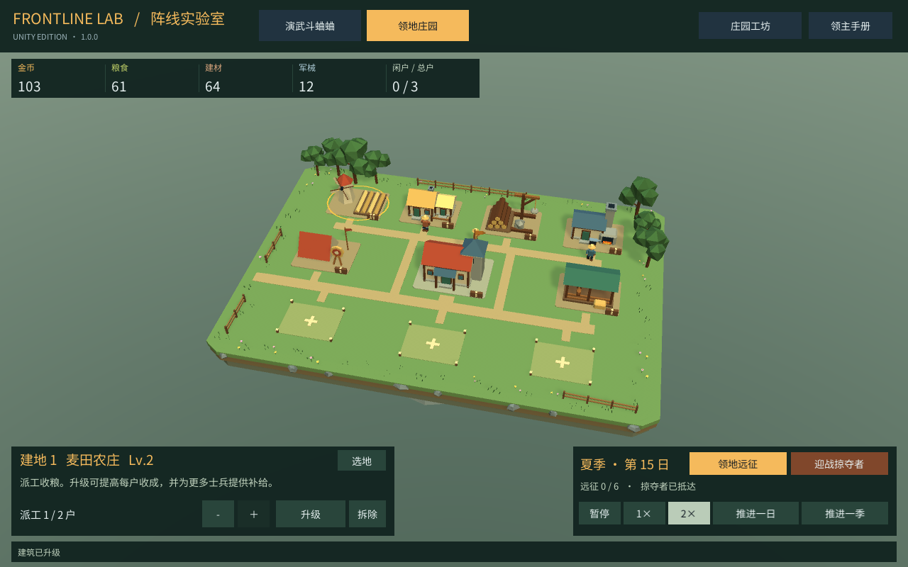
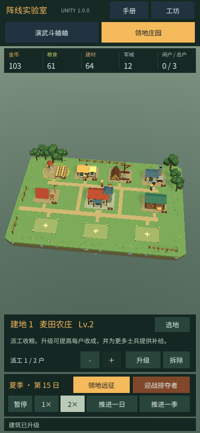

# 阵线实验室 Unity 1.0.0 验证记录

Windows x64 和 WebGL Release 已在 Unity 6000.6.9f1 构建。两种模式共用 Frontline 场景、实例渲染、HUD、输入、音频和固定 60 Hz 的 UnityWorld。演武沿用 unity-0.9.0 战斗规则、0.6.0 布阵和 v3 轨迹。

## 领地庄园

中央宅邸和九处建地位于 26 × 18 米台地。六种功能建筑支持建造、升级至三级和拆除。农舍每级提供一户住房。领民在已派工的建筑与住所间搬运，模型和建筑均以实例绘制，地块使用平面射线与距离拾取。七类建筑、农帽和包裹各烘焙两级 LOD。清单包含 146 个网格，原 128 个网格及其元数据与基线一致。

金币、粮食、建材、军械和住户在日结时更新。游戏提供暂停、1×、2×、推进一日和推进一季。一季设为十二日。缺粮暂停增长，并将出征兵力上限降至三人。宅邸升至二、三级分别需要攻克一关、三关。

从驻军与道具库存选兵后，游戏生成标准布阵，进入现有物理战场。六关依次为 meadow、bridge、ruins、marsh、highland、island。也可主动巡边或迎战定期出现的掠夺者。战后所有生还者及阵亡者中的三分之一（总数向上取整）归营，携行道具消耗。胜利发放物资，首次攻破当前关卡解锁下一关。结果生成时保存待返回的最终账本，返回时显示结算；在战果页退出后可恢复当次收益。

## 程序与历史规则

- npm test 通过 98 项 JavaScript 和 103 项纯 C# 检查，共 201 项。新增的庄园检查涵盖收费原子性、户数上下界、缺粮、征募层级、严格读档、选兵及行军预算、战损与战利品和六关解锁。
- npm run test:physics 与 Windows Release checks 均通过，Editor 和 Windows 的两次重复轨迹均与 0.9.0 原件逐字节相同。
- src、test、scripts、历史哈希锁、现行战斗内核和 PhysX 适配器已与 0.9.5 提交比对。协程先清除运行状态，再触发开战或回放。桌面地图标题底板 418 × 78；战力条宽度变化超过 0.25 像素才写回。视图复用相同坐标的地面高度。
- Editor 启动产生了与 0.9.5 相同的 UnityEditor.Search 索引异常。调用栈指向编辑器索引服务，物理检查继续执行并以 0 退出。

| 引擎 | 步数 | 胜方 | 轨迹 SHA256 |
|---|---:|---|---|
| unity-0.6.0 | 1847 | red | `195ba6c8be9e0eb0dad461e58fab4cb978b5f1266462c6b80c16dee0011bcc16` |
| unity-0.7.0 | 2279 | blue | `bdef881f7548d614c6633f635ad1472d92f5bcaebac4c44b59b4241535197249` |
| unity-0.8.0 | 1468 | blue | `076718f93f0f15e2991ce24fb0a8497d3945a58dbaea576180ad7704d961364d` |
| unity-0.9.0 | 1623 | blue | `f8c495f01364232b21a662f5581ed5d63e97a91ff6377486f7fc1a83af0f1831` |

六图 smoke 汇总 SHA256 为 `e8a85c36cf79720636cdab8dd32f707f8ac37f742f2c156bab91a9efa2fd6efc`。每张图的完整轨迹分别与 0.9.0 对应文件进行了字节比较。

| 地图 | 步数 | 胜方 | 轨迹帧 |
|---|---:|---|---:|
| meadow | 1703 | red | 285 |
| bridge | 1723 | blue | 289 |
| island | 2260 | red | 378 |
| ruins | 2479 | red | 415 |
| marsh | 3204 | blue | 535 |
| highland | 2682 | red | 448 |

## 成品与性能

- `FRONTLINE_BUILD_OK StandaloneWindows64 82189842 bytes 00:00:12.8508127`
- `FRONTLINE_BUILD_OK WebGL 18430142 bytes 00:01:39.3510849`

Windows Release 串行启动。每种快照模式独立启动三次，每次预热一轮、测量五轮。每轮 720 步，每六步记录快照，表中为全部 15 个 45v45 样本的中位数。

| 45v45 快照 | 实测 ms/步 | 门槛 ms/步 |
|---|---:|---:|
| prepared | 0.298588 | ≤ 0.31 |
| fresh | 0.301771 | ≤ 0.33 |

各视口分别对 45v45 与 60v60 采样 360 帧。WebGL 使用本机 Edge 与 Intel GPU，在宽度为 390 像素的触屏仿真视口验收。表中的 P95 是该采样场景的帧耗时。

| 成品视口 | 兵力 | 中位帧 ms | P95 ms | 中位 Draw Calls |
|---|---:|---:|---:|---:|
| Windows · 1280×800 | 45v45 | 16.67 | 16.73 | 92 |
| Windows · 1280×800 | 60v60 | 16.67 | 16.70 | 135 |
| Web1280 · 1280×800 | 45v45 | 8.00 | 9.00 | 90 |
| Web1280 · 1280×800 | 60v60 | 8.00 | 9.00 | 133 |
| Web390 · 390×844 | 45v45 | 8.00 | 9.00 | 61 |
| Web390 · 390×844 | 60v60 | 8.00 | 9.00 | 93 |

## 操作与存档

三种视口分别以独立验收存档走完同一条流程。Unity 通过屏幕坐标拾取建地，使用 EventSystem 命中可见 UGUI 控件，完成建造、派工增减、手动日/季、自动日结、建筑升级、招兵和造道具。随后选择上阵队伍，调整至布阵阶段，进入真实 PhysX 战斗、下达鼓舞令，返回并核对库存、奖品、通关进度、PlayerPrefs 与演武原布阵。另实测迎敌、战中退出、算策取消、普通人机自动开战。

| 视口 | 操作记录 | 远征步数 | 胜方 | 归营后的常备军 |
|---|---:|---:|---|---:|
| Windows | 55 | 317 | red | 7 |
| Web1280 | 55 | 316 | red | 7 |
| Web390 | 55 | 316 | red | 7 |

工坊文件交换使用正常游戏界面、Windows 系统文件对话框及浏览器的文件选择和下载。每个方向均比对原件与再次导出的完整字节。

| 存档方向 | 游戏日 | 字节 | 往返 SHA256 |
|---|---:|---:|---|
| web-native → web-via-windows | 16 | 723 | `823152043c78b28045867a9745d61ae7ad2576a7142bb85855a5178c8ab4d6d5` |
| windows-native → windows-via-web | 17 | 723 | `5ca6987664b3295d824c80edd732ddd826cd7c6dfa5d6444305f7b4f25e8d619` |

Windows 原生双 Bot Bo3 共 2 局，公开观察 112 次，接收军令 12 次，拒收 0 次，超时 0 次。

